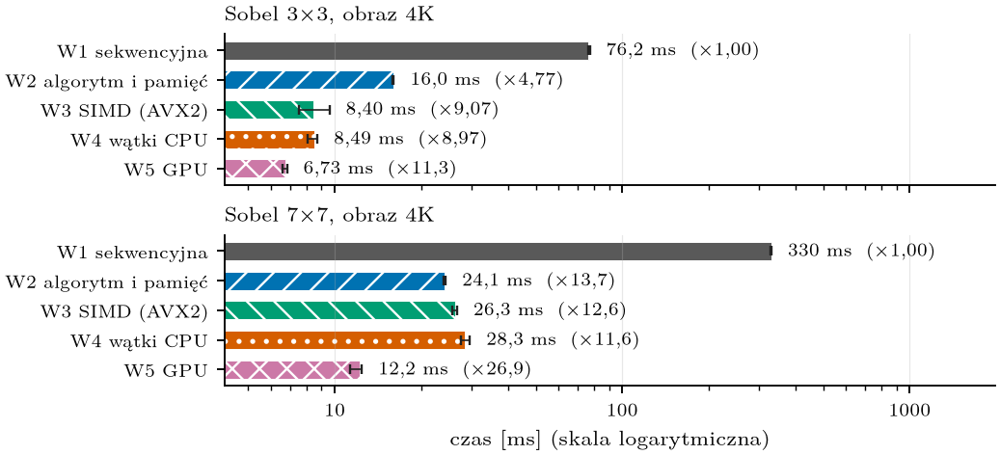
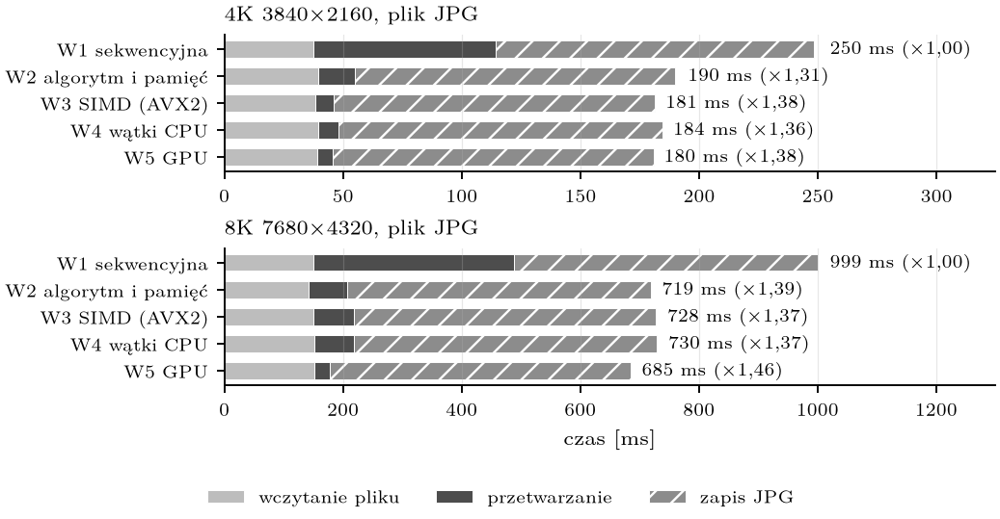
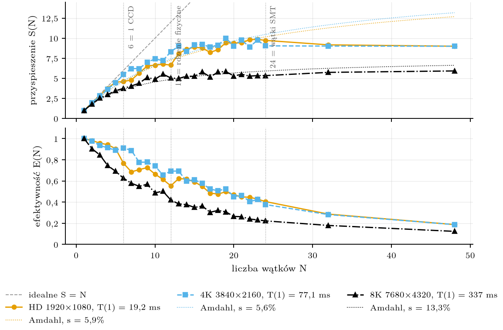
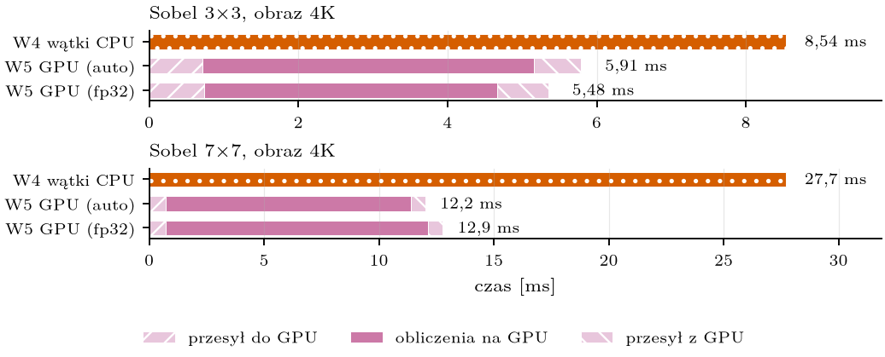
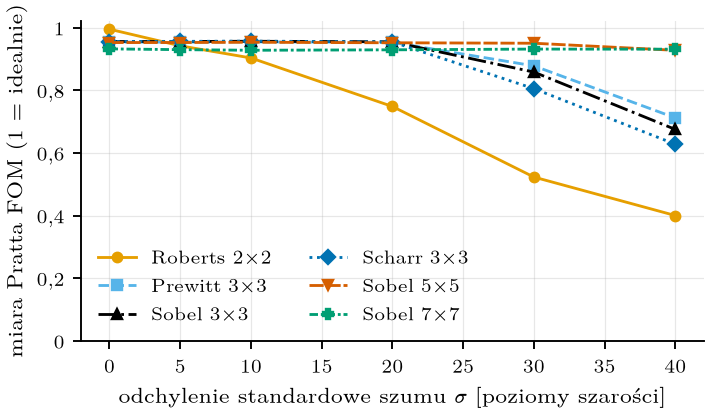
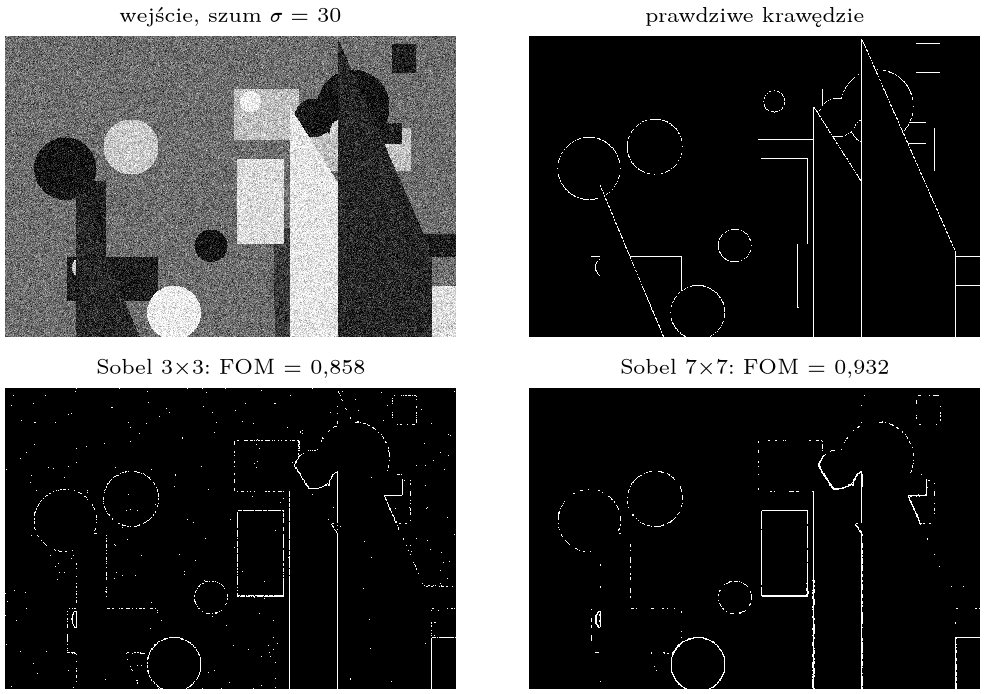
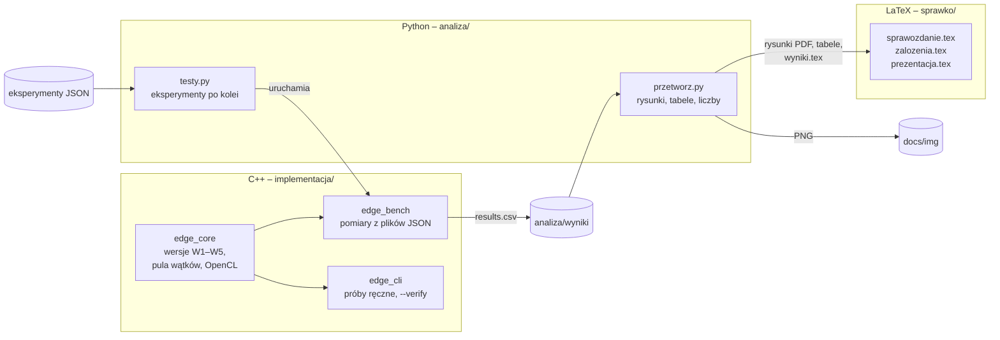

<div align="center">

# Wielowątkowe wykrywanie krawędzi

**Mechanizmy zarządzania wątkami programowymi w zadaniu wykrywania krawędzi na obrazach cyfrowych
z wykorzystaniem operatorów gradientowych**

Projekt z przedmiotu *Zarządzanie w systemach i sieciach komputerowych* · Politechnika Wrocławska, W4N, semestr 7, 2026


[Sprawozdanie (PDF)](sprawko/sprawozdanie.pdf) ·
[Założenia projektu (PDF)](sprawko/zalozenia.pdf) ·
[Prezentacja (PDF)](sprawko/prezentacja.pdf)

</div>

---

## Spis treści

- [O projekcie](#o-projekcie)
- [Pięć wersji programu](#pięć-wersji-programu)
- [Najważniejsze wyniki](#najważniejsze-wyniki)
- [Jak to działa](#jak-to-działa)
- [Struktura repozytorium](#struktura-repozytorium)
- [Uruchomienie](#uruchomienie)
- [Eksperymenty](#eksperymenty)
- [Dokumenty](#dokumenty)
- [Sprzęt pomiarowy](#sprzęt-pomiarowy)
- [Autorzy](#autorzy)

---

## O projekcie

Program wykrywa krawędzie na obrazie w skali szarości operatorami gradientowymi (Sobel 3×3, 5×5, 7×7, Prewitt,
Scharr, Roberts). Dla każdego piksela liczy moduł gradientu

$$G(x,y) = \sqrt{G_x^2 + G_y^2},\qquad G_x = K_x * I,\quad G_y = K_y * I,$$

a wynik skaluje do zakresu 0–255 względem największej wartości w obrazie.

Celem projektu jest **zmierzenie, ile czasu oszczędza każdy rodzaj przyspieszenia**: od optymalizacji kodu na
jednym rdzeniu, przez instrukcje wektorowe i wątki, po kartę graficzną. Najwięcej uwagi poświęcono
mechanizmom zarządzania wątkami: liczbie wątków, strategii przydziału pracy, synchronizacji, puli wątków
i przypisaniu wątków do rdzeni.

Każdą z wersji porównano z wersją sekwencyjną na tych samych danych. Wszystkie dają **wynik identyczny co do bitu**
(sprawdzone na 10 368 przypadkach testowych), więc różnią się wyłącznie czasem.

## Pięć wersji programu

Wersje **nie narastają**: każda bierze kod bazowy W1 i dodaje do niego jeden rodzaj przyspieszenia.
Dzięki temu widać wkład jednego mechanizmu, a nie sumę kilku.

| Wersja | Rodzaj przyspieszenia | Co się zmienia względem W1 | Poziom równoległości |
|:------:|-----------------------|----------------------------|----------------------|
| **W1** | brak (punkt odniesienia) | splot 2D wprost, `std::clamp` przy każdym odczycie, maska w `std::vector` | – |
| **W2** | algorytm i pamięć, 1 rdzeń | brzegi poza główną pętlą, maska `constexpr`, **splot rozdzielny** (4k zamiast 2k² operacji), bufory `int16` używane wielokrotnie | – |
| **W3** | wektoryzacja SIMD, 1 rdzeń | ten sam algorytm co W1, ale **8 pikseli na instrukcję** (AVX2) | instrukcji |
| **W4** | wątki na rdzeniach CPU | jądro W1 + **własna pula wątków i scheduler** (static / cyclic / dynamic / guided), 1–48 wątków | zadań |
| **W5** | karta graficzna | kernel **OpenCL**, 1 wątek GPU = 1 piksel (lub kilka), przesył przez PCIe | danych (masowa) |

## Najważniejsze wyniki

Pomiary z 9.11.2026: mediana z 15 powtórzeń, obraz 4K (3840×2160), sam algorytm (bez wczytania i zapisu pliku).

| Wersja | Sobel 3×3 | przyspieszenie | Sobel 7×7 | przyspieszenie |
|--------|----------:|---------------:|----------:|---------------:|
| W1 sekwencyjna | 76,2 ms | 1,0× | 330 ms | 1,0× |
| W2 algorytm i pamięć | 16,0 ms | 4,8× | 24,1 ms | 13,7× |
| W3 SIMD (AVX2) | 8,40 ms | 9,1× | 26,3 ms | 12,6× |
| W4 wątki (24) | 8,49 ms | 9,0× | 28,3 ms | 11,6× |
| W5 GPU | 6,73 ms | 11,3× | 12,2 ms | 26,9× |

<p align="center">
  
  <br><sub>Czas samego algorytmu dla masek Sobela 3×3 i 7×7 (obraz 4K, wspólna oś w skali logarytmicznej).</sub>
</p>

**Wnioski w skrócie:**

- **Algorytm przed sprzętem.** Dla maski 7×7 sama zmiana algorytmu na jednym rdzeniu (W2, splot rozdzielny)
  dała więcej niż 8-krotna wektoryzacja i 24 wątki.
- **Prawo Amdahla w praktyce.** Wczytanie i zapis pliku JPG trwają dłużej niż cały algorytm W1. Dlatego cały
  program przyspieszył najwyżej **1,38×**, choć sam algorytm przyspieszył 9–12×.
- **Wątki nie skalują się liniowo.** W4 osiąga S(24) ≈ 9 dla 4K i tylko ≈ 5,3 dla 8K. Część sekwencyjna
  (jednowątkowy przydział buforów) to ok. 6 % i 13 %, a obraz 8K nie mieści się w pamięci L3.
- **Synchronizacja ma znaczenie.** `std::mutex` przy każdym pikselu jest 39× wolniejszy niż lokalne maksimum
  z redukcją, a fałszywe współdzielenie (false sharing) 3,8× wolniejsze.
- **GPU wygrywa od ok. 3,7 Mpix** i przy dużych maskach. Mniej wątków GPU liczących po kilka pikseli skraca
  obliczenia na karcie 2,4×.
- **Większa maska nie zawsze jest lepsza.** Bez szumu najlepszy jest Roberts 2×2, przy silnym szumie
  (σ = 40) Sobel 7×7.

<table>
  <tr>
    <td width="50%"></td>
    <td width="50%"></td>
  </tr>
  <tr>
    <td align="center"><sub>Cały program: wczytanie, algorytm i zapis JPG. Zapis dominuje.</sub></td>
    <td align="center"><sub>W4: przyspieszenie S(N) i efektywność E(N) z krzywą prawa Amdahla.</sub></td>
  </tr>
  <tr>
    <td width="50%"></td>
    <td width="50%"></td>
  </tr>
  <tr>
    <td align="center"><sub>W5: przesył na kartę, obliczenia i przesył wyniku wobec W4.</sub></td>
    <td align="center"><sub>Jakość krawędzi (miara Pratta) w funkcji poziomu szumu.</sub></td>
  </tr>
</table>

<p align="center">
  
  <br><sub>Obraz z szumem σ = 30, prawdziwe krawędzie oraz krawędzie wykryte maskami Sobela 3×3 i 7×7.</sub>
</p>

Pełna analiza z opisem mechanizmów każdego wyniku: [sprawko/sprawozdanie.pdf](sprawko/sprawozdanie.pdf), punkt 7.

## Jak to działa



- **Jedno wejście do wszystkich wersji.** `VariantRunner::run(wersja, obraz, maska, konfiguracja)` w
  [`implementacja/core/variants.cpp`](implementacja/core/variants.cpp) – te same granice pomiaru czasu dla W1–W5.
- **Poprawność przed wydajnością.** Przed każdym pomiarem `edge_bench --verify` porównuje wszystkie wersje z W1.
  Moduł gradientu liczony jest w podwójnej precyzji, więc wynik nie zależy od kolejności działań.
- **Jedno źródło liczb.** Każda liczba w sprawozdaniu pochodzi z plików CSV przez makro `\wynik{klucz}`
  generowane przez [`analiza/przetworz.py`](analiza/przetworz.py). W plikach `.tex` nie ma ręcznie wpisanych wyników.
- **Rzetelne pomiary.** Eksperymenty uruchamiane są po kolei, z rozgrzewką i 11–15 powtórzeniami, tylko przy
  zajętości CPU poniżej 5 % i regulatorze częstotliwości w trybie `performance`. Wynik to mediana z zakresem min–maks.

## Struktura repozytorium

<pre>
<a href=".">.</a>
├── <a href="implementacja/">implementacja/</a>                 kod C++17 (CMake + Ninja)
│   ├── <a href="implementacja/core/">core/</a>                      biblioteka edge_core – cała logika, bez Qt
│   │   ├── <a href="implementacja/core/variants.h">variants.h</a>, <a href="implementacja/core/variants.cpp">variants.cpp</a>   tabela wersji i VariantRunner – wejście do W1–W5
│   │   ├── <a href="implementacja/core/variants/">variants/</a>              jądra obliczeniowe (W3: <a href="implementacja/core/variants/w3_simd.cpp">w3_simd.cpp</a>)
│   │   ├── <a href="implementacja/core/kernels_ref.h">kernels_ref.h</a>          kod referencyjny W1
│   │   ├── <a href="implementacja/core/edge_detector.cpp">edge_detector.cpp</a>      W4: podział pracy, redukcja maksimum, przypinanie
│   │   ├── <a href="implementacja/core/thread_pool.h">thread_pool.h</a>          pula wątków
│   │   ├── <a href="implementacja/core/row_scheduler.h">row_scheduler.h</a>        harmonogramy static / cyclic / dynamic / guided
│   │   ├── <a href="implementacja/core/topology.cpp">topology.cpp</a>           topologia CPU (CCD, SMT) z /sys
│   │   ├── <a href="implementacja/core/gpu/">gpu/</a>                   W5: kernele OpenCL
│   │   ├── <a href="implementacja/core/verify.cpp">verify.cpp</a>             weryfikacja wszystkich wersji względem W1
│   │   ├── <a href="implementacja/core/harness.cpp">harness.cpp</a>            przebieg eksperymentu, zapis CSV
│   │   └── <a href="implementacja/core/filter.h">filter.h</a>               moduł gradientu i skalowanie (wspólne dla wszystkich wersji)
│   ├── <a href="implementacja/bench/main.cpp">bench/</a>                     edge_bench – aplikacja pomiarowa (Qt 6 Core)
│   ├── <a href="implementacja/cli/main.cpp">cli/</a>                       edge_cli – próby ręczne i weryfikacja
│   └── <a href="implementacja/ai/PROMPT.md">ai/</a>                        procedura wariantu od AI
├── <a href="analiza/">analiza/</a>                       Python: pomiary, przetwarzanie, rysunki
│   ├── <a href="analiza/eksperymenty/">eksperymenty/</a>              16 eksperymentów (JSON), E0–E14
│   ├── <a href="analiza/wyniki/">wyniki/</a>                    surowe wyniki pomiarów (CSV + meta.json)
│   ├── <a href="analiza/pelny_przebieg.py">pelny_przebieg.py</a>          cały łańcuch jednym poleceniem
│   ├── <a href="analiza/testy.py">testy.py</a>                   uruchamianie eksperymentów z kontrolą obciążenia
│   ├── <a href="analiza/przetworz.py">przetworz.py</a>               rysunki, tabele i makra \wynik{} do sprawozdania
│   └── <a href="analiza/przygotuj_obrazy.py">przygotuj_obrazy.py</a>        obrazy testowe (skalowanie, obrazy z szumem)
├── <a href="sprawko/">sprawko/</a>                       dokumenty LaTeX
│   ├── <a href="sprawko/sprawozdanie.pdf">sprawozdanie.pdf</a>           sprawozdanie końcowe
│   ├── <a href="sprawko/zalozenia.pdf">zalozenia.pdf</a>              opis założeń projektu
│   ├── <a href="sprawko/prezentacja.pdf">prezentacja.pdf</a>            slajdy
│   ├── <a href="sprawko/zrzuty/">zrzuty/</a>                    rysunki (generowane)
│   └── <a href="sprawko/tabele/">tabele/</a>                    tabele (generowane)
├── <a href="obrazy/">obrazy/</a>                        obrazy testowe – źródła i licencje w <a href="obrazy/ZRODLA.md">ZRODLA.md</a>
├── <a href="materialy/">materialy/</a>                     materiały prowadzącego – opis każdego pliku w <a href="materialy/INDEKS.md">INDEKS.md</a>
│   ├── <a href="materialy/projekt/">projekt/</a>                   wymagania, wzory założeń i strony tytułowej, terminy
│   └── <a href="materialy/wyklady/">wyklady/</a>                   wykłady ZSK_1–7, pytania zaliczeniowe
└── <a href="docs/img/">docs/img/</a>                      rysunki PNG do tego pliku (generowane przez przetworz.py)
</pre>

## Uruchomienie

### Wymagania

| Narzędzie | Wersja | Uwagi |
|-----------|--------|-------|
| Linux | Ubuntu 24.04 | topologia CPU czytana z `/sys`, przypinanie wątków przez `pthread_setaffinity_np` |
| GCC | 13 | C++17, OpenMP |
| CMake + Ninja | 3.x | |
| Qt | 6 (moduł Core) | tylko do `edge_bench` |
| OpenCL | 1.2+ | opcjonalnie – bez niego W5 jest pomijana (`ocl-icd-opencl-dev`) |
| Python | 3.12 | pakiety w [`analiza/requirements.txt`](analiza/requirements.txt) |
| LaTeX | pdflatex | do kompilacji dokumentów |

### Kompilacja

```bash
cmake -S implementacja -B implementacja/build -G Ninja -DCMAKE_BUILD_TYPE=Release -DCMAKE_PREFIX_PATH=$HOME/Qt/6.12.0/gcc_64
```

```bash
cmake --build implementacja/build
```

### Próba ręczna

```bash
./implementacja/build/edge_cli --list-variants
```

```bash
./implementacja/build/edge_cli -v W4 -t 24 -m sobel3 -i obrazy/kodim08.png -o /tmp/krawedzie.png
```

```bash
./implementacja/build/edge_cli --verify -v W1,W2,W3,W4,W5
```

### Pełne pomiary i sprawozdanie

```bash
python3 -m venv analiza/.venv && analiza/.venv/bin/pip install -r analiza/requirements.txt
```

```bash
analiza/.venv/bin/python analiza/pelny_przebieg.py --quick
```

```bash
analiza/.venv/bin/python analiza/pelny_przebieg.py --yes --force
```

`--quick` to próba całego łańcucha w kilkanaście sekund (wyniki w `/tmp`). Pełny przebieg – kompilacja,
weryfikacja, 15 eksperymentów, rysunki i PDF – trwa ok. 17 minut. Przed pomiarami należy zamknąć inne programy.
Duży obraz źródłowy NASA nie jest w repozytorium; polecenie pobrania jest w [`obrazy/ZRODLA.md`](obrazy/ZRODLA.md).

## Eksperymenty

| Plik | Pytanie | Wersja |
|------|---------|--------|
| [E1_wersje](analiza/eksperymenty/E1_wersje.json) | Ile daje każdy rodzaj przyspieszenia (sam algorytm)? | W1–W5 |
| [E1b_calosc](analiza/eksperymenty/E1b_calosc.json) | Jak czas dzieli się na wczytanie, algorytm i zapis? | W1–W5 |
| [E2_maski](analiza/eksperymenty/E2_maski.json) | Jak rozmiar i rodzaj maski wpływa na czas? | W1–W5 |
| [E3_watki](analiza/eksperymenty/E3_watki.json) | Przyspieszenie S(N), efektywność E(N), prawo Amdahla | W4 |
| [E4_harmonogramy](analiza/eksperymenty/E4_harmonogramy.json) | Strategia przydziału × rozmiar fragmentu | W4 |
| [E6_mechanizmy](analiza/eksperymenty/E6_mechanizmy.json) | Pula wątków czy nowe wątki w każdym etapie? | W4 |
| [E8_normalizacja](analiza/eksperymenty/E8_normalizacja.json) | Ile kosztuje bariera między etapami? | W4 |
| [E8b_redukcja](analiza/eksperymenty/E8b_redukcja.json) | Mutex, atomic, false sharing przy wyznaczaniu maksimum | W4 |
| [E9_amdahl](analiza/eksperymenty/E9_amdahl.json) | Przyspieszenie całego programu z plikami JPG | W4 |
| [E10_topologia](analiza/eksperymenty/E10_topologia.json) | Przypisanie wątków do rdzeni (CCD, SMT) | W4 |
| [E5_gpu](analiza/eksperymenty/E5_gpu.json) | Przesył PCIe a obliczenia, rozmiar obrazu, precyzja | W5 |
| [E5b_gpu_watki](analiza/eksperymenty/E5b_gpu_watki.json) | Liczba wątków GPU i rozmiar grupy roboczej | W5 |
| [E13_rozmiar](analiza/eksperymenty/E13_rozmiar.json) | Czas i przepustowość dla obrazów 0,04–59 Mpix | W1–W5 |
| [E13b_tresc](analiza/eksperymenty/E13b_tresc.json) | Czy treść obrazu wpływa na czas? | W1–W5 |
| [E14_jakosc](analiza/eksperymenty/E14_jakosc.json) | Czy większa maska daje lepsze krawędzie? (miara Pratta) | W1 |

Surowe wyniki każdego eksperymentu: `analiza/wyniki/<eksperyment>/results.csv` (czasy wszystkich powtórzeń),
`correctness.csv` (porównanie z W1) i `meta.json` (sprzęt, kompilator, flagi, wersja kodu).

## Dokumenty

| Dokument | Zawartość |
|----------|-----------|
| [Założenia projektu](sprawko/zalozenia.pdf) | temat i cel, sformułowanie problemu, złożoność, metoda i algorytmy W1–W5, narzędzia, plan testów |
| [Sprawozdanie](sprawko/sprawozdanie.pdf) | strona tytułowa, punkty założeń rozwinięte, realizacja i wyniki wszystkich eksperymentów, propozycje dalszych przyspieszeń, wnioski |
| [Prezentacja](sprawko/prezentacja.pdf) | slajdy na prezentację końcową |

## Sprzęt pomiarowy

| | |
|---|---|
| Procesor | AMD Ryzen 9 9900X – 12 rdzeni / 24 wątki, 2 bloki CCD po 32 MB L3, 1 MB L2 na rdzeń, AVX2 i AVX-512 |
| Karta graficzna | NVIDIA GeForce GTX 1050 Ti – 768 rdzeni CUDA, 4 GB |
| System | Ubuntu 24.04, GCC 13.3, flagi `-O3` |

## Autorzy

**Karol Gąsior** · **Mateusz Kunicki**

Prowadzący: dr inż. Robert Wójcik · grupa G2 · Politechnika Wrocławska, Wydział Informatyki i Telekomunikacji

<sub>Obrazy testowe: NASA Earth Observatory (Blue Marble, domena publiczna) oraz Kodak Lossless True Color Image Suite –
szczegóły w <a href="obrazy/ZRODLA.md">obrazy/ZRODLA.md</a>.</sub>
